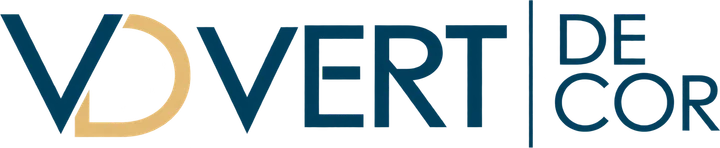
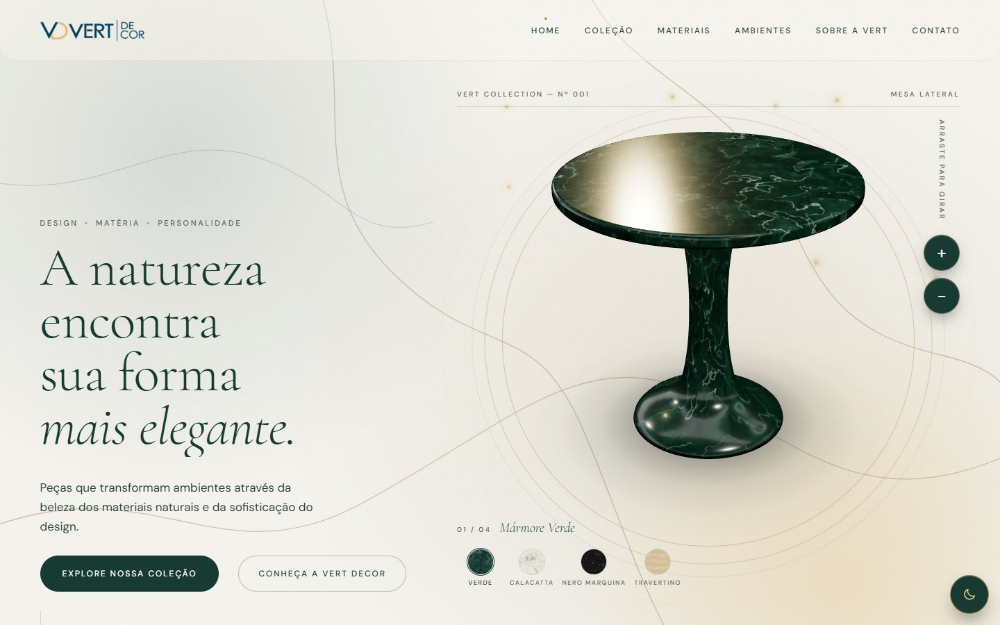
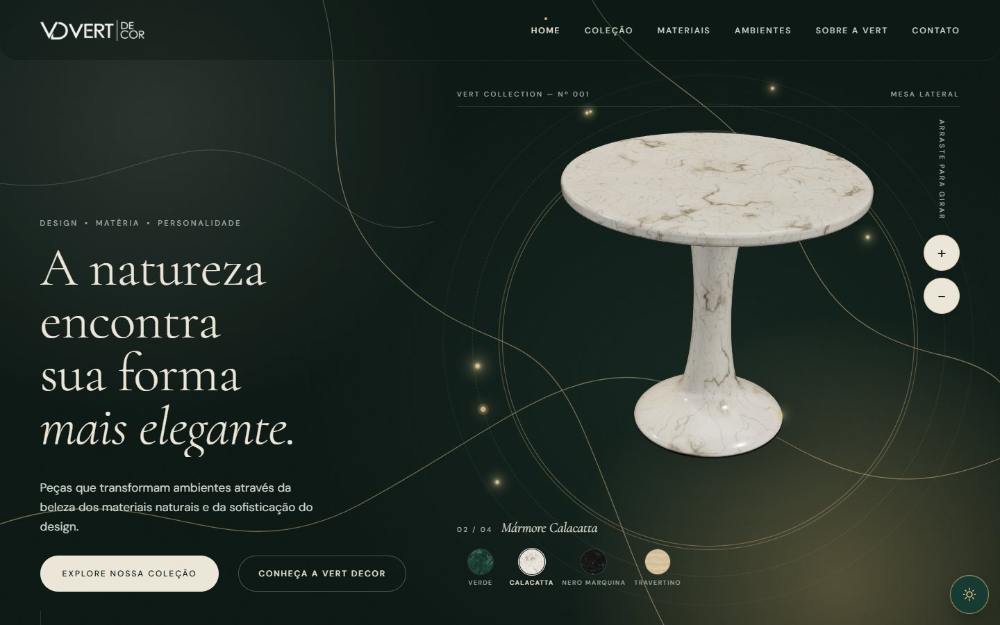
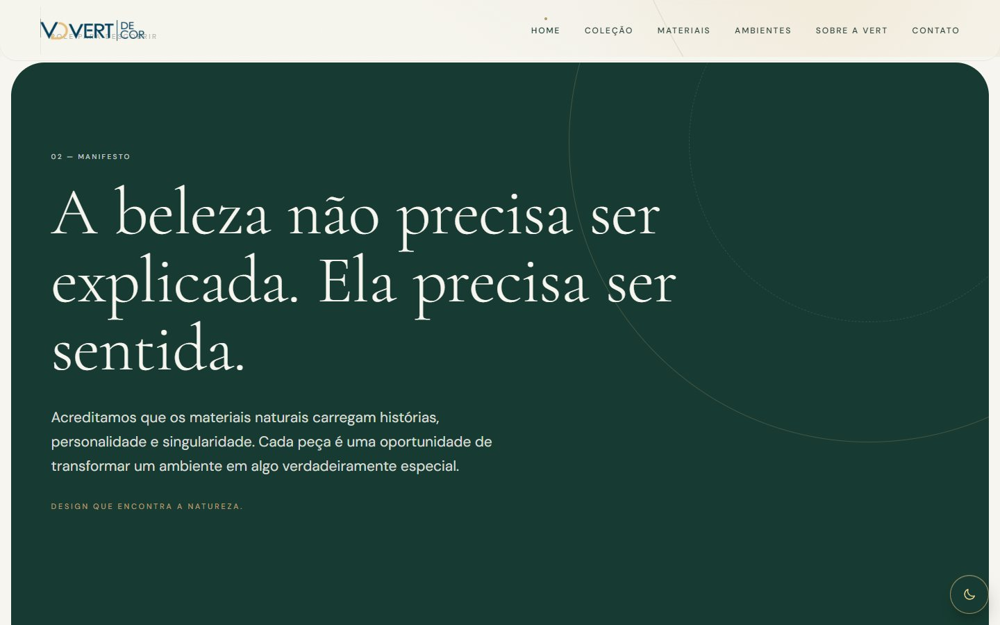
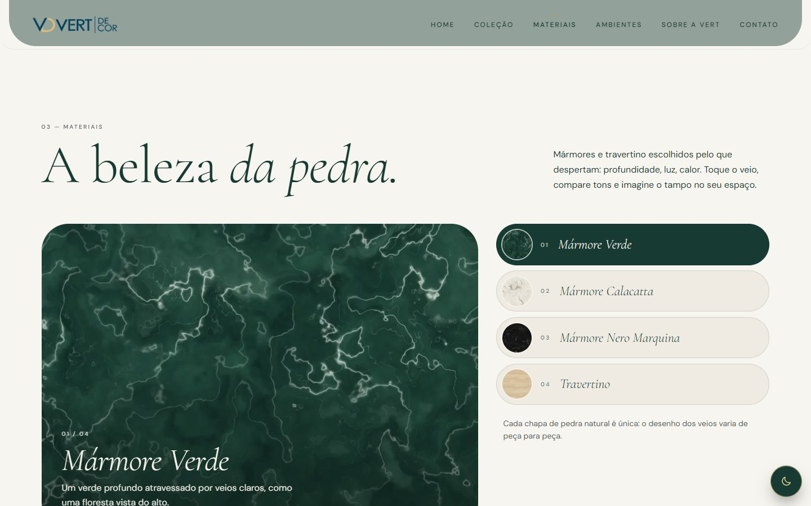
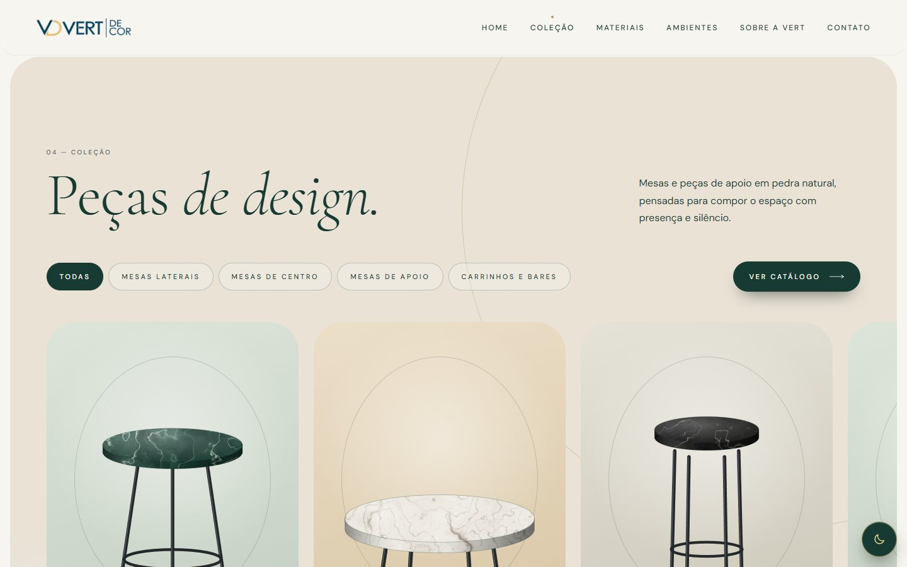
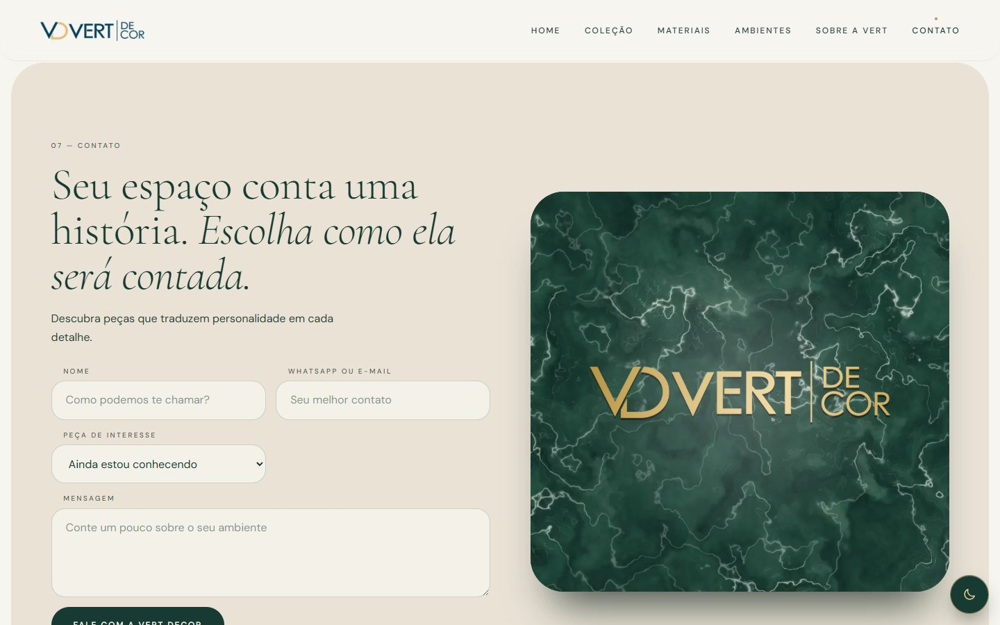
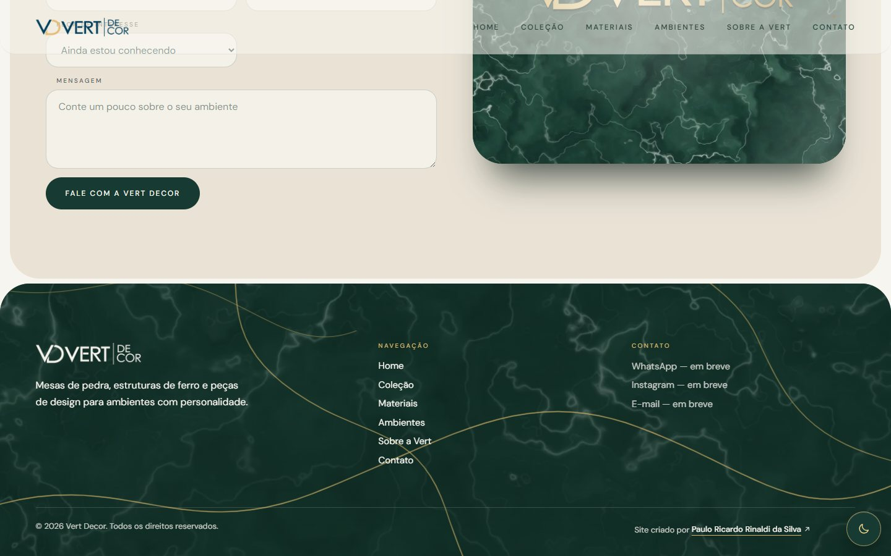
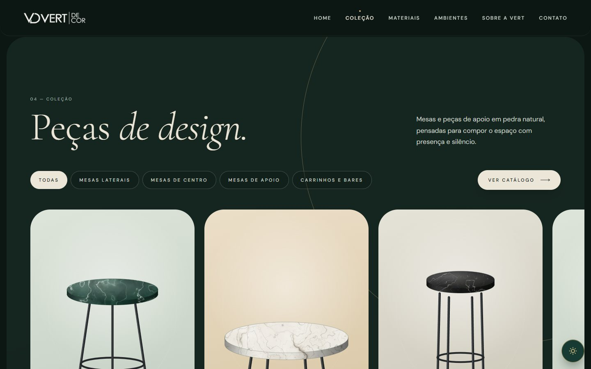

<div align="center">



### Mesas de mármore, ferro e design contemporâneo.
**Organic Luxury** — um site onde a pedra é a protagonista.


<br />



</div>

---

## ✦ A ideia

A **Vert Decor** vende mesas com **tampo de mármore e estrutura de ferro**. O site traduz isso em uma experiência
editorial: pouco ruído, muito espaço, tipografia elegante e uma peça 3D que o visitante pode girar, ampliar e trocar de pedra.

> *"A beleza não precisa ser explicada. Ela precisa ser sentida."*

---

## ✦ O que tem aqui

### Hero 3D interativo
Mesa de pedestal modelada proceduralmente (**React Three Fiber**), com troca de pedra em tempo real
(Verde · Calacatta · Nero Marquina · Travertino), zoom, rotação por arraste, partículas champagne, luz quente em órbita
e giro de entrada. Um poster estático é o LCP; o Three.js só carrega depois.

<table>
  <tr>
    <td width="50%"></td>
    <td width="50%"></td>
  </tr>
  <tr>
    <td align="center"><sub>Tema claro · mármore verde</sub></td>
    <td align="center"><sub>Tema escuro · mármore branco</sub></td>
  </tr>
</table>

### Tela de carregamento
Cortina em arco que sobe revelando a Home. É 100% CSS, aparece no primeiro frame do HTML pré-renderizado e
comanda a coreografia de entrada do Hero e da navbar.

### Manifesto, Materiais e Coleção

<table>
  <tr>
    <td width="33%"></td>
    <td width="33%"></td>
    <td width="33%"></td>
  </tr>
  <tr>
    <td align="center"><sub>Manifesto, palavra a palavra</sub></td>
    <td align="center"><sub>Seletor de pedras</sub></td>
    <td align="center"><sub>Carrossel + filtros + catálogo</sub></td>
  </tr>
</table>

- **Coleção** em carrossel (arraste, toque, setas do teclado), filtro por categoria, **"Ver catálogo"** em grade e painel de detalhe (`<dialog>` nativo).
- Peças ilustradas em vetor: **tampo de pedra sobre estrutura de ferro**, texturizadas com as próprias pedras.
- **Ambientes** em carrossel, com a peça em destaque em cada cena.

### Contato com uma placa de mármore
Formulário à esquerda; à direita, uma **placa de mármore com a logo estampada em ouro** que inclina com o mouse ou com o dedo
(limitada a ±11°, volta suavemente ao repouso).

<table>
  <tr>
    <td width="50%"></td>
    <td width="50%"></td>
  </tr>
</table>

### Tema claro e escuro
Botão flutuante no canto inferior direito, com revelação circular (*View Transitions API*), escolha salva e aplicada
**antes da primeira pintura** (sem flash). No escuro, os mármores verdes viram **brancos**.



### Detalhes que importam
- Navbar de **vidro fosco**: o conteúdo (e a mesa ampliada) aparece borrado por trás dela.
- Layout **sem cantos vivos**: seções em painéis arredondados, botões em pílula.
- Rodapé como **laje de mármore** com veios dourados que se desenham ao entrar na tela.
- Acessibilidade: foco visível, navegação por teclado, `prefers-reduced-motion` respeitado, contraste AA.

---

## ✦ Stack

| Camada | Tecnologias |
|---|---|
| **Base** | React 19 · TypeScript · Vite |
| **3D** | three · @react-three/fiber · @react-three/drei (carregado sob demanda) |
| **Estilo** | Sass · Bootstrap 5 (só fundação, grid e utilitários) · variáveis CSS para os temas |
| **Fontes** | Cormorant Garamond + DM Sans (self-host via `@fontsource`) |
| **Build** | Pré-renderização estática (HTML hidratado), CSS crítico inline |
| **Ferramentas** | sharp (imagens) · simplex-noise (texturas procedurais) · puppeteer-core (posters) |

> Sem checkout, carrinho, pagamentos, admin ou banco de dados: o escopo atual é **somente a Home**.
> Os dados em `src/data/` já seguem um formato compatível com futuros modelos Prisma (ids, slugs, relações peça↔pedra).

---

## ✦ Rodando

```bash
npm install
npm run dev        # desenvolvimento
npm run build      # tsc + build + pré-renderização
npm run preview    # serve o build (porta 4173)
```

Outros comandos:

```bash
npm run textures         # regenera as texturas procedurais das pedras (-- <id> para uma só)
npm run posters          # renderiza os posters do Hero a partir da própria cena 3D
node scripts/optimize-logo.mjs   # gera as versões otimizadas da logo
```

> 💡 **Windows + OneDrive:** se o `npm run build` falhar com `EPERM` ao limpar a pasta `dist`,
> pare o `npm run preview` antes de buildar.

Rode `npm run posters` sempre que mudar câmera, luz, mesa ou texturas do Hero.

---

## ✦ Performance

A regra do projeto é **Lighthouse ≥ 90** em todas as categorias, e **desempenho tem prioridade sobre efeito visual**.

| | Desempenho | Acessibilidade | Boas práticas | SEO |
|---|:-:|:-:|:-:|:-:|
| **Desktop** | 98 | 100 | 100 | 100 |
| **Mobile** | 86–93 ¹ | 100 | 100 | 100 |

¹ O mobile oscila entre rodadas (LCP simulado ≈ 3 s) e fica na fronteira dos 90.

Decisões que sustentam isso:

- Home **pré-renderizada** no build; JS só carrega depois do primeiro frame.
- Poster AVIF/WebP é o **LCP**; o **Three.js (~270 KB gz) só carrega** na primeira interação (ou automaticamente em desktop potente, após a abertura).
- Tudo abaixo da dobra é **um chunk lazy**, com hidratação fatiada pelo React.
- Texturas e imagens pesadas só são pedidas quando a seção se aproxima (`useNear`).
- Sombra da mesa *baked*; animações só de `transform`/`opacity`; `content-visibility` nas seções pesadas.
- Criar um contexto WebGL só para testar suporte custava ~1 s de TBT no mobile — agora só roda quando o 3D vai carregar.

---

## ✦ Estrutura

```
src/
├─ components/
│  ├─ layout/        Navbar, menu mobile, Footer
│  ├─ sections/      Hero, Manifesto, Materiais, Coleção, Ambientes, Sobre, Contato
│  ├─ three/         cena, mesa procedural, pedra, sombra baked
│  └─ ui/            Loader, Carousel, Logo, ThemeToggle
├─ data/             materiais, produtos, ambientes, textos, contato
├─ hooks/            useReveal, useNear, useScrollSpy…
├─ styles/           tokens, temas (claro/escuro), Bootstrap enxuto
└─ entry-server.tsx  pré-renderização
docs/                identidade, arquitetura, performance, status e specs por seção
scripts/             texturas, posters, logo, prerender
```

Mais detalhes em [`docs/`](docs/): identidade visual, arquitetura, estratégia de performance e o
[status](docs/status.md) do projeto.

---

## ✦ Identidade

| | |
|---|---|
| **Verde floresta** `#173B32` | identidade, profundidade |
| **Areia** `#E9E2D5` · **Off-white** `#F7F5EF` | predominantes |
| **Champagne** `#B39A70` | detalhes, com moderação |

Direção visual: fotografias grandes, composições assimétricas, espaço negativo generoso, texturas naturais e
contraste entre pedra, ferro e luz. Evitar: cara de template, e-commerce genérico, excesso de bordas e gradientes sem propósito.

---

## ✦ Placeholders (a preencher com dados reais)

O projeto **não inventa dados da marca**. Estes pontos estão marcados e centralizados:

- **Peças e ambientes** são fictícios e ilustrativos (`src/data/products.ts`, `src/data/environments.ts`) — trocar pelo catálogo e fotografias oficiais.
- **WhatsApp, Instagram e e-mail** em `src/data/contact.ts` (enquanto vazios, o botão e o rodapé mostram "em breve").
- **Texturas das pedras** são procedurais e provisórias (`public/textures/`); substituir por scans reais mantendo os nomes.
- **Domínio** (canonical e `og:image` absoluto) ainda não definido.
- **Cores da logo oficial** (azul petróleo + dourado) divergem da paleta do briefing — confirmar com a marca.

---

<div align="center">

<sub>Site criado por <a href="https://paulodev.pauloricardoodev.workers.dev"><b>Paulo Ricardo Rinaldi da Silva</b></a></sub>

</div>
